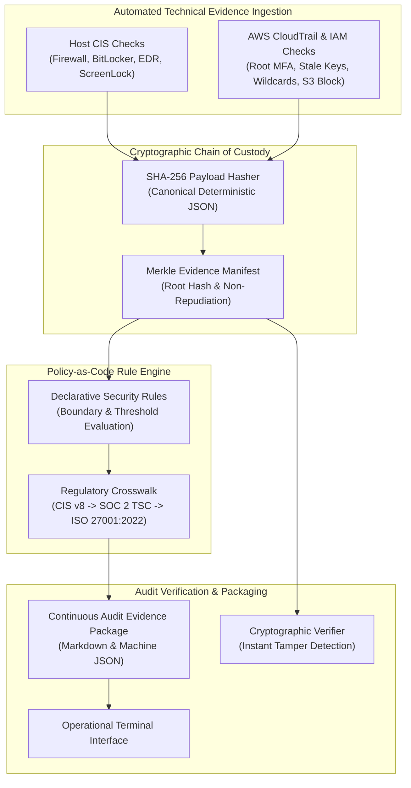

# Compliance-as-Code Evidence Agent

[](https://www.python.org/downloads/)
[-brightgreen.svg)]()
[]()
[]()

An enterprise Compliance-as-Code agent that automates continuous technical evidence collection, Policy-as-Code evaluation, and cryptographic chain-of-custody verification mapped directly to **CIS Controls v8**, **SOC 2 Type II (Trust Services Criteria)**, and **ISO/IEC 27001:2022**.

Engineered to eliminate manual screenshot collection and audit fatigue by providing auditors with immutable, machine-verifiable evidence packages.

---

## 📌 Executive Problem Statement

Traditional GRC and security audit preparation is slow, error-prone, and painful:
1. **Screenshot Fatigue & Manual Toil:** Engineers and compliance analysts spend weeks manually taking screenshots of firewall settings, IAM policies, and cloud configurations for SOC 2 Type II or ISO 27001 audits.
2. **Missing Evidence Lineage:** Auditors (Big 4 / SOC 2 assessors) frequently challenge the integrity, freshness, and authenticity of static screenshots because they lack non-repudiation and cryptographic proof.
3. **Disjointed Cloud & Endpoint Posture:** Organizations often inspect endpoints and cloud infrastructure through separate, incompatible tools without a unified Policy-as-Code layer.

**Solution:** This agent runs **continuously and deterministically**. It queries both host operating system settings and cloud security logs (AWS CloudTrail, IAM, and S3), hashes raw configurations using **SHA-256 at point of capture**, anchors all items in a **Merkle root manifest**, and evaluates posture against declarative Policy-as-Code rules mapped directly to SOC 2 and ISO 27001 controls.

---

## 🏗️ System Architecture



---

## 🛡️ Automated Checks & Regulatory Crosswalk

The agent continuously collects and verifies **11 authoritative technical controls**:

| Check ID | Source Domain | CIS Benchmark | SOC 2 Criteria | ISO 27001:2022 | Technical Audit Objective |
|---|---|---|---|---|---|
| **`CIS-HOST-1.1`** | Endpoint | CIS v8 4.4 | `CC6.6` | `A.8.20`, `A.8.23` | Host firewall active across Domain, Private, and Public profiles with inbound blocking |
| **`CIS-HOST-1.2`** | Endpoint | CIS v8 3.11 | `CC6.1`, `CC6.7` | `A.8.24`, `A.8.1` | Full disk encryption (BitLocker/LUKS) with AES-256 on OS partition |
| **`CIS-HOST-1.3`** | Endpoint | CIS v8 4.10 | `CC6.1` | `A.7.7`, `A.8.1` | Automatic workstation screen lock after $\le$ 15 minutes of inactivity |
| **`CIS-HOST-1.4`** | Endpoint | CIS v8 10.1 | `CC6.8` | `A.8.7` | Active real-time anti-malware and behavior monitoring protection with updated signatures |
| **`CIS-HOST-1.5`** | Endpoint | CIS v8 7.1 | `CC7.1` | `A.8.8` | Operating system build currency and automatic security update delivery |
| **`CIS-HOST-1.6`** | Endpoint | CIS v8 5.2 | `CC6.1` | `A.5.17`, `A.8.5` | Minimum password length $\ge$ 12, history enforcement $\ge$ 24, and lockout threshold |
| **`AWS-IAM-01`** | Cloud Identity | CIS AWS 1.5 | `CC6.1`, `CC6.2` | `A.8.2`, `A.8.5` | AWS root account MFA active with zero active programmatic access keys |
| **`AWS-IAM-02`** | Cloud Identity | CIS AWS 1.14 | `CC6.2` | `A.8.5` | Programmatic access key age $\le$ 90 days across all IAM users |
| **`AWS-IAM-03`** | Cloud Identity | CIS AWS 1.16 | `CC6.3` | `A.5.15`, `A.8.2` | Least-privilege IAM policy audit (detects overly permissive `Action: *` wildcards) |
| **`AWS-S3-01`** | Cloud Storage | CIS AWS 2.1.5 | `CC6.6` | `A.8.12`, `A.8.20` | Account-level S3 Block Public Access enabled across all four settings |
| **`AWS-TRAIL-01`** | Cloud Audit | CIS AWS 3.1 & 3.2 | `CC7.2` | `A.8.15`, `A.8.16` | Multi-region CloudTrail enabled with immutable log file validation active |

---

## 🔒 Cryptographic Chain of Custody (SHA-256 Merkle Root)

To satisfy rigorous external audit and evidentiary standards:
1. **Canonical JSON Serialization:** All captured raw configurations are stripped of non-deterministic formatting and serialized with sorted keys (`canonical_json`).
2. **Atomic Evidence Digest:** Each evidence item receives a 64-character SHA-256 hash binding the `check_id`, `resource_id`, `collected_at` timestamp, and `raw_data`.
3. **Merkle Root Manifest:** All item hashes are sorted and composited into a root manifest digest (`manifest_sha256`).
4. **Instant Tamper Detection:** Any retroactive modification to a raw setting, timestamp, or policy threshold immediately invalidates both the item hash and the root manifest digest during `verify`.

---

## 🚀 Quickstart & Usage

### Prerequisites
- Python 3.10+ (tested on Python 3.13)

### Installation
```bash
git clone https://github.com/KhaieJay1/compliance-evidence-agent.git
cd compliance-evidence-agent
pip install -r requirements.txt
```

### CLI Command Reference

#### 1. Display Audit Coverage & Metrics
```bash
python -m src.cli stats
```
```text
=== COMPLIANCE-AS-CODE AGENT METRICS ===
Total Automated Checks:        11
Host CIS Benchmark Checks:     6
Cloud (AWS IAM/Trail/S3) Checks: 5
Mapped SOC 2 Criteria:         8 unique criteria (CC6.1, CC6.2, CC6.3, CC6.6, CC6.7, CC6.8, CC7.1, CC7.2)
Mapped ISO 27001:2022 Controls: 14 unique controls
Cryptographic Integrity:       SHA-256 canonical Merkle root verification active
```

#### 2. Inspect Framework Crosswalk Mappings
```bash
python -m src.cli mappings
```

#### 3. Collect Technical Evidence with Cryptographic Hashing
```bash
python -m src.cli collect
```
```text
Executing continuous evidence collection (Host CIS + AWS CloudTrail/IAM)...

[+] Successfully collected 11 evidence artifacts with SHA-256 digests.
Manifest ID:   MNF-2026-10-20-9745a037
Manifest Root: 9745a0370b0274e752d13a92d95e789828e35a6fda8c8e4697bcf4d10cba853e

+--------------+----------------+----------------------------------------+------------------+
| Check ID     | Source Type    | Evidence Title                         | SHA-256 Digest   |
+==============+================+========================================+==================+
| CIS-HOST-1.1 | HOST_SYSTEM    | Host Firewall Status & Active Profiles | 5704b47b80a6...  |
| CIS-HOST-1.2 | HOST_SYSTEM    | Full Disk Encryption Status (BitLocker | 8b5828910fc9...  |
| CIS-HOST-1.3 | HOST_SYSTEM    | Unattended Session Screen Lock & Inact | 5da9598b9ddd...  |
| CIS-HOST-1.4 | HOST_SYSTEM    | Antivirus & EDR Real-Time Protection S | 4d9162142613...  |
| CIS-HOST-1.5 | HOST_SYSTEM    | Operating System Build & Security Patc | 5207a561d195...  |
| CIS-HOST-1.6 | HOST_SYSTEM    | Local Account Password Policy & Histor | af8ee0f6941d...  |
| AWS-IAM-01   | AWS_IAM        | AWS Root Account MFA Enforcement       | 52bf75aaff25...  |
| AWS-IAM-02   | AWS_IAM        | AWS IAM Inactive & Stale Access Key Au | 40b7efcb8ee5...  |
| AWS-IAM-03   | AWS_IAM        | AWS Least Privilege IAM Policy Analysi | 119c0a89d2dd...  |
| AWS-S3-01    | AWS_S3         | AWS S3 Account-Level Block Public Acce | b75921ee9989...  |
| AWS-TRAIL-01 | AWS_CLOUDTRAIL | AWS CloudTrail Multi-Region Logging &  | 43d5e53a5fd3...  |
+--------------+----------------+----------------------------------------+------------------+

Manifest saved to: evidence_store/evidence_manifest.json
```

#### 4. Cryptographically Verify Evidence Manifest
```bash
python -m src.cli verify
```
```text
Verifying cryptographic integrity of stored evidence manifest...

[+] INTEGRITY VERIFIED (PASS): All evidence hashes and Merkle root digest match exactly.
Zero tampering, alteration, or evidence omission detected.
```

#### 5. Execute Policy-as-Code Evaluation & Export Audit Package
```bash
# Terminal summary
python -m src.cli evaluate

# Export executive Markdown audit report with remediation steps
python -m src.cli evaluate --output markdown --save evidence_store/audit_report_soc2_iso27001.md
```

---

## 📋 Sample Audit Package Output

```markdown
# SOC 2 & ISO 27001 Continuous Compliance Audit Package
**Organization:** `Enterprise FinTech Ltd` | **Audit Timestamp:** `2026-10-20 14:48:22 UTC`
**Audit Package ID:** `AUDIT-PKG-2026-10-20-6f0b9435`
**Cryptographic Manifest Root Hash (SHA-256):**  
`6f0b943509f9bfd129af94b3fcae520ad1c4ee64100271bae95fc2ad3a4fb99a`

## 1. Executive Summary & Audit Scorecard
| Metric | Value |
|---|---|
| **Overall Compliance Score** | **90.9%** |
| **Total Policy Controls Evaluated** | 11 |
| **Passed Controls** | 10 (Conforming) |
| **Failed Controls** | 1 (Deficiencies Found) |
| **Evidence Integrity Chain** | **100% Cryptographically Verified (SHA-256)** |

### Control Evaluation Highlights:
- **`CIS-HOST-1.2` (Disk Encryption):** `[PASS] COMPLIANT`  
  *Crosswalk:* SOC 2 CC6.1, CC6.7 | ISO 27001 A.8.24, A.8.1  
  *Digest:* `ac050004efead4477aeb07fbaf45aba1287dfde308c14a96a9af47901c2eef9b`  
  *Finding:* Compliance verified: Full Disk Encryption (BitLocker AES-256) active.

- **`AWS-IAM-03` (Least Privilege Wildcard Check):** `[FAIL] NON-COMPLIANT`  
  *Crosswalk:* SOC 2 CC6.3 | ISO 27001 A.5.15, A.8.2  
  *Digest:* `5fbe80a46c5d7ac8f1a0b6bf064fe5b4d431e618cc875cf1c46fc36d2fbc1bbf`  
  *Finding:* NON-COMPLIANCE DETECTED: 1 customer managed policy contains full admin wildcard (`Action: *`, `Resource: *`).  
  *Remediation Required:* Refactor violating IAM policy into scoped micro-permissions according to least privilege.
```

---

## 🧪 Testing & Verification

The suite contains **18 unit and integration tests** verifying canonical serialization, SHA-256 hash generation, Merkle root verification, tamper detection, collector execution, Policy-as-Code operators, and CLI subcommands.

To run the complete test suite:
```bash
python -m pytest tests -v
```
```text
============================= test session starts =============================
platform win32 -- Python 3.13.3, pytest-9.1.1, pluggy-1.7.0
rootdir: ./compliance-evidence-agent
collected 18 items

tests/test_agent.py::test_agent_end_to_end_audit PASSED                  [  5%]
tests/test_cli.py::test_cli_stats PASSED                                 [ 11%]
tests/test_cli.py::test_cli_mappings PASSED                              [ 16%]
tests/test_cli.py::test_cli_collect PASSED                               [ 22%]
tests/test_cli.py::test_cli_verify PASSED                                [ 27%]
tests/test_cli.py::test_cli_evaluate PASSED                              [ 33%]
tests/test_collectors.py::test_host_collector_all_checks PASSED          [ 38%]
tests/test_collectors.py::test_cloud_collector_all_checks PASSED         [ 44%]
tests/test_crypto.py::test_canonical_json_key_order_invariance PASSED    [ 50%]
tests/test_crypto.py::test_sha256_computation PASSED                     [ 55%]
tests/test_crypto.py::test_evidence_integrity_tamper_detection PASSED    [ 61%]
tests/test_crypto.py::test_manifest_merkle_root_integrity PASSED         [ 66%]
tests/test_mapper.py::test_mapper_lookup_valid PASSED                    [ 72%]
tests/test_mapper.py::test_mapper_lookup_nonexistent PASSED              [ 77%]
tests/test_mapper.py::test_soc2_coverage PASSED                          [ 83%]
tests/test_mapper.py::test_iso27001_coverage PASSED                      [ 88%]
tests/test_policy_engine.py::test_policy_engine_pass PASSED              [ 94%]
tests/test_policy_engine.py::test_policy_engine_fail_wildcard_admin PASSED [100%]

============================= 18 passed in 11.64s =============================
```

---

## ⚖️ Scope, Simulated Telemetry & Limitations

- **Live vs. Baseline Host Checks:** `CIS-HOST-1.1` queries the live Windows Firewall state via PowerShell (`Get-NetFirewallProfile`) when executed on Windows, while `CIS-HOST-1.2` through `1.6` return structured baseline telemetry dictionaries so the suite runs without requiring elevated Administrator privileges (`manage-bde` / `secedit`) or risking local machine configuration exposure. The target host identifier defaults to `workstation-prod-01` (configurable via `GRC_TARGET_HOST`).
- **Simulated AWS Cloud Fixtures:** Cloud posture checks (`AWS-IAM-01` through `AWS-TRAIL-01`) evaluate realistic synthetic IAM, S3, and CloudTrail JSON fixtures (`data/sample_cloudtrail/sample_events.json`) rather than calling live AWS Boto3 APIs, ensuring zero cloud credential exposure.
- **Cryptographic Integrity Scope:** Each evidence item and manifest is bound via canonical sorted-key JSON and SHA-256 digests (`manifest_sha256` composite root digest) to detect post-collection file tampering. Production deployments should pair this hash chain with an external KMS/HSM asymmetric key signature (`aws kms sign` / Cosign) and immutable WORM storage (S3 Object Lock).

---

## 📁 Repository Structure

```text
compliance-evidence-agent/
├── README.md                      # Executive documentation & architecture
├── requirements.txt               # Dependencies (pydantic, tabulate, pytest)
├── .gitignore                     # Git exclusion rules
├── evidence_store/                # Generated audit manifests & packages
│   ├── evidence_manifest.json     # Signed evidence manifest with Merkle root hash
│   ├── audit_package.json         # Complete machine-readable audit package
│   └── audit_report_soc2_iso27001.md # Formatted auditor Markdown report
├── src/
│   ├── __init__.py
│   ├── models.py                  # Pydantic data schemas & Enums
│   ├── crypto.py                  # Canonical JSON serialization & SHA-256 Merkle root
│   ├── mapper.py                  # CIS Controls v8 -> SOC 2 -> ISO 27001 crosswalk
│   ├── policy_engine.py           # Declarative Policy-as-Code rule evaluation engine
│   ├── agent.py                   # Automated compliance agent orchestrator
│   ├── reporter.py                # Terminal, Markdown, and JSON audit formatters
│   ├── cli.py                     # CLI entrypoint (collect, evaluate, verify, stats)
│   └── collectors/
│       ├── __init__.py
│       ├── host_collector.py      # CIS host checks (firewall, BitLocker, EDR, screen lock)
│       └── cloud_collector.py     # AWS IAM, S3, and CloudTrail audit log collector
└── tests/                         # Pytest test suite (18 unit & integration tests)
    ├── conftest.py
    ├── test_agent.py
    ├── test_cli.py
    ├── test_collectors.py
    ├── test_crypto.py
    ├── test_mapper.py
    └── test_policy_engine.py
```

---

## 🔒 Confidentiality & Safe Execution

- **Zero Real Secret Leakage:** No proprietary cloud credentials, tokens, or private organization keys are exposed.
- **Air-Gapped & Local:** Can execute in completely isolated, offline CI/CD or staging environments.
- **Deterministic:** Reliable, reproducible audit evidence for external assessors.

---

## 👤 Author

**Kayode J. Afuvape, CCIBS**  
*Chartered Banker (Chartered Banker Institute) | Governance, Risk & Compliance (GRC) | Financial Crime & Analytics*  
- **GitHub:** [KhaieJay1](https://github.com/KhaieJay1)  
- **Specializations:** SOC 2 Type II, ISO 27001:2022, CIS Controls, Continuous Compliance, AWS Security, AML/CTF.
